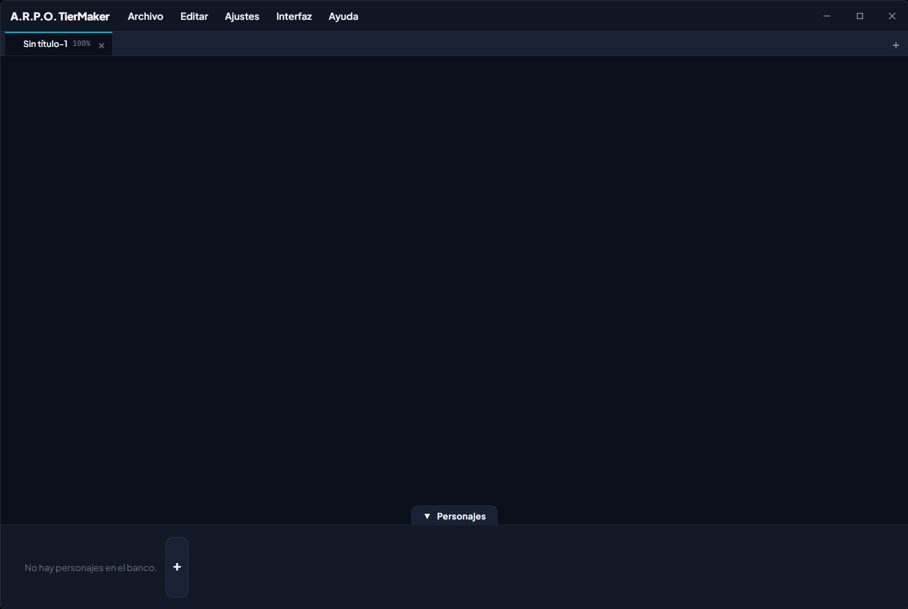

<p align="center"></p>

# ARPO TierMaker

ARPO TierMaker es una aplicación de escritorio para crear árboles de relaciones de poder objetivas (A.R.P.O.). Permite organizar personajes en un lienzo, conectarlos y editar visualmente sus relaciones. Está construida con Rust y Tauri, con una interfaz HTML, CSS y JavaScript.



## Funciones

- Crear varios lienzos en pestañas y organizar personajes y conexiones.
- Importar imágenes, editar personajes y ajustar la presentación del lienzo.
- Guardar y abrir proyectos JSON; exportar el lienzo como PNG o JPG.
- Deshacer y rehacer cambios, activar la recuperación automática y elegir entre tema claro y oscuro e idioma español o inglés.

## Descargar y ejecutar en Windows

1. Descarga `ARPO-TierMaker.exe` desde [Releases](https://github.com/JorgeCodex/ARPO_TierMaker/releases/latest).
2. Ejecuta el archivo descargado. La aplicación utiliza Microsoft Edge WebView2 Runtime; si no está instalado, instala el [runtime de WebView2](https://developer.microsoft.com/microsoft-edge/webview2/).
3. Añade personajes desde el panel inferior y utiliza el menú **Archivo** para guardar, abrir o exportar tu trabajo.

El ejecutable publicado está compilado para Windows x64. No es un instalador.

## Ejecutar desde el código fuente

Necesitas Windows x64, [Rust](https://rustup.rs/), las herramientas de compilación de C++ para Visual Studio y Microsoft Edge WebView2 Runtime. Después de instalarlas, abre una terminal en la raíz del proyecto:

```powershell
cargo run
```

La primera ejecución descarga y compila las dependencias. Para generar un ejecutable optimizado con la interfaz incluida:

```powershell
cargo build --release --features tauri/custom-protocol
```

El ejecutable se genera en `target/release/arpo-tiermaker.exe`.

## Estructura

- `frontend/`: interfaz y recursos visuales.
- `src/`: código Rust para la ventana y los archivos de proyecto.
- `tauri.conf.json`: configuración de la aplicación Tauri.
- `docs/`: captura de la aplicación.
